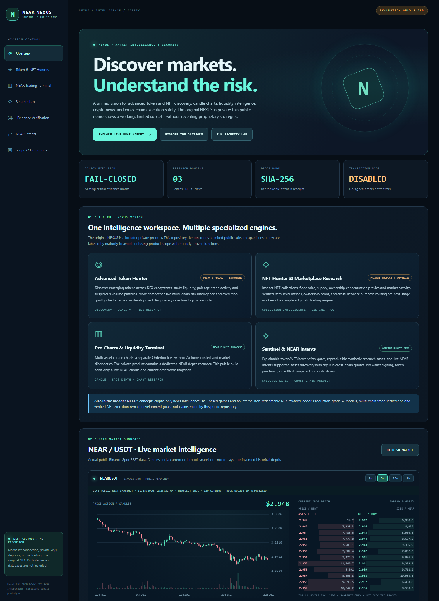

# NEAR NEXUS — Market Intelligence & Sentinel Public Showcase

**NEAR HACKATHON 2026 | Primary track: AI Security & Defense | Related scope: Unstoppable DeFi & Open Innovation**

This repository is a CLEAN, INDEPENDENT, runnable public demonstration, not the original NEXUS product. Its Git history starts here. No private trading strategies, Hunter models, wallet secrets, archived datasets, account databases, or private source code are included.

*Screenshot of the working public demo. Market values are a point-in-time snapshot, not a guarantee of current prices.*

## Product vision — what NEXUS is building

NEXUS is a broader, privately developed multi-chain market-intelligence workspace. The goal is one interface that brings together **advanced Token Hunter**, **NFT Hunter**, **professional candle and orderbook charts**, **crypto-only news**, **NEAR Intents**, and a **pre-execution security layer**.

The original product is NOT this public repository. The public showcase demonstrates isolated functions without exposing proprietary scoring, selection strategies, market data archives, trading models or wallets.

| Area | Original private product / current status | This public repository |
| --- | --- | --- |
| Advanced Token Hunter | Public DEX token radar exists; deeper multi-chain discovery and stronger risk assessment are continuing work. Private Hunter strategy integration is not publicly demonstrated. | High-level vision and transparent security research cases only; no hunter model code. |
| NFT Hunter | Public collection-level research exists; ownership and listing verification, multi-network execution are incomplete. | High-level vision and synthetic NFT safety case; no actual listing purchase. |
| Professional trading charts | Candle charts and market diagnostics exist in original NEXUS; new indicator overlays and interaction controls require isolated development and testing. | A fresh public live NEARUSDT candlestick viewer (Binance Spot REST) with 1m, 5m, 15m and 1h views. |
| NEAR historical orderbook | **Most mature recorder:** live NEAR Spot L2 recording, five hours of sampled quantitative depth history and archived visual image tiles in the original private environment (not full historical trade-by-trade events). | **Current NEAR Spot depth snapshot only**, up to 12 displayed bid and ask levels from public REST. No recorded L2 files or historical heatmap exposed. |
| BTC / ETH / SOL / SUI orderbooks | Separate capture flows exist, but scaling, visual quality and cross-symbol parity with NEAR are NOT fully validated. | Not exposed or claimed as complete. |
| Security / NEAR Intents | Prototype policy checks and NEAR integration, further wallet and settlement validation pending. | Reproducible fail-closed research demo, live 1Click catalog, guarded dry-quote preview. |
| Games / NEX | Three skill-based games and a non-redeemable internal NEX ledger exist privately; there is no blockchain-mining or cash-out claim. | Vision described only. |

**Technical distinction:** Binance REST candlesticks are not the same stream as historical orderbook depth. This repository does not attempt to recreate the original private L2 recorder or claim that any additional asset's heatmap is finalized.

## Problem and product

A token's reported liquidity, an NFT collection's floor price, or a crypto-news headline is not evidence that a trade is safe or executable. NEXUS Sentinel demonstrates an explainable, conservative research gate that exposes missing information before any financial action.

The prototype provides:
- A LIVE NEARUSDT Spot candlestick viewer and current orderbook depth snapshot from public Binance REST (no private history, no trade execution).
- Four clearly SYNTHETIC token, NFT, and crypto-news research cases.
- Deterministic fail-closed policy checks with explicit BLOCK / WARN reasons.
- Reproducible SHA-256 receipts with evidence-consistency and policy verification.
- A LIVE read-only catalog from the official NEAR Intents 1Click provider.
- Optional constrained provider quote preview that ALWAYS sends dry:true, never signs a transaction, and never returns a deposit address.

**NOT CLAIMED:** a trained AI model, production wallet firewall, independent contract audit, validated investment strategy, onchain attestation, actual token/NFT trading, real cross-chain settlement, or publisher-first news timestamp proof.

## Judge walkthrough — do X, see Y

Prerequisite: Node.js 24+; public network for live NEAR provider features.

    npm test
    npm start

Open http://127.0.0.1:4315

1. Open the **NEAR Trading Terminal**: inspect live candle OHLCV and the current two-sided orderbook snapshot, switch 1m/5m/15m/1h and confirm provider timestamp. The private five-hour recorder is intentionally not in this repository.
2. Explore the capability cards: advanced Token Hunter, NFT Hunter, professional charts, and Sentinel all have clearly stated maturity levels.
3. Press RUN 4 SAFETY TESTS. Expect verdicts WARN, BLOCK, BLOCK, WARN, all with research-only status.
4. Select a card: inspect exact evidence, warnings and blocking reasons.
5. Press VERIFY SELECTED RECEIPT. Expect a VALID consistency result.
6. Press TAMPER & VERIFY. Expect INVALID; evidence was modified without regenerating the digest.
7. Press LOAD LIVE ASSETS. If the public NEAR Intents 1Click catalog is reachable, see supported-asset counts for NEAR, SOL, ETH, Base and Sui. If not reachable, see a transparent provider error, not fabricated data.
8. Optional dry quote: supply valid supported asset IDs, an atomic amount below the $100 preview limit, chain-valid refund/recipient addresses, and slippage in [10,300] bps. The provider may reject unsupported routes. NO funds move.

No API key, wallet, external secrets, or database is needed. Test files mock the provider, while the running UI uses the real provider or returns a clear error.

## API

- GET /api/v1/health — demo health, non-executing status
- GET /api/v1/market/near?interval=5m — live NEARUSDT Spot candles and current depth snapshot (1m/5m/15m/1h), public Binance only
- GET /api/v1/demo/scenarios — four synthetic cases
- POST /api/v1/demo/assess — JSON: { "type": "token", "evidence": {} }; also nft and news
- POST /api/v1/demo/verify — JSON: { "receipt": { ... } }
- GET /api/v1/near/assets — current supported 1Click assets (provider network required)
- POST /api/v1/near/quote — strict dry:true provider quote only, NEVER funds transfer

The server listens only on loopback 127.0.0.1 by default. Do not expose it publicly without separately auditing the reverse proxy, access controls, traffic limits and TLS.

## Technical and safety boundaries

- No real trade or wallet-signing endpoints; all user-provided inputs are for research.
- The market viewer displays only real, provider-returned Spot candles and current orderbook snapshots; it fails visibly if unavailable, never generates synthetic market numbers. It uses no Binance API keys.
- Only NEAR is available in the public orderbook viewer. BTC/ETH/SOL/SUI are *not* claimed to have production-equivalent chart/heatmap support.
- Checksums are NOT digital signatures, tamper-proof onchain records or independent timestamp evidence. A party capable of replacing a whole receipt can also recompute its hash.
- NFT floor is NOT a purchasable listing. Reported token data is NOT a contract or holder audit.
- A news publisher date is NOT independently verified first publication time.
- Read-only catalog may fail due to network/rate limits; the app will NOT show synthetic results as live.
- Quote preview uses supported IDs, syntactic chain-address checks, capped amount and slippage; address validation is NOT proof of wallet ownership.
- The public policy is simplified educational logic, NOT NEXUS private trading/security strategies.

## Hackathon development boundary

NEXUS is an existing integrated market/security platform. Its private earlier product and historical code are excluded. During the qualifying development window the NEXUS Sentinel safety-research concept and NEAR Intents integration were built. This repository presents a fresh **standalone sanitized demonstration** of those ideas and does not assert that the full private product is published or audited.

Original project, proprietary strategies, databases, internal service architecture, wallets, and source history remain private. No private original Git history was copied.

## License

See LICENSE for limited noncommercial evaluation rights. This is source-available, NOT an OSI open-source license; there is no grant covering the private NEXUS platform.

## References

NEAR hackathon rules: https://nearhackathon.com/HACKATHON.md
NEAR Intents 1Click API: https://docs.near-intents.org/
NEAR Intents public token catalog: https://1click.chaindefuser.com/v0/tokens

Demo post on X with @NEARProtocol and #NEARHackathon must be published separately by the project owner before submitting the project.
